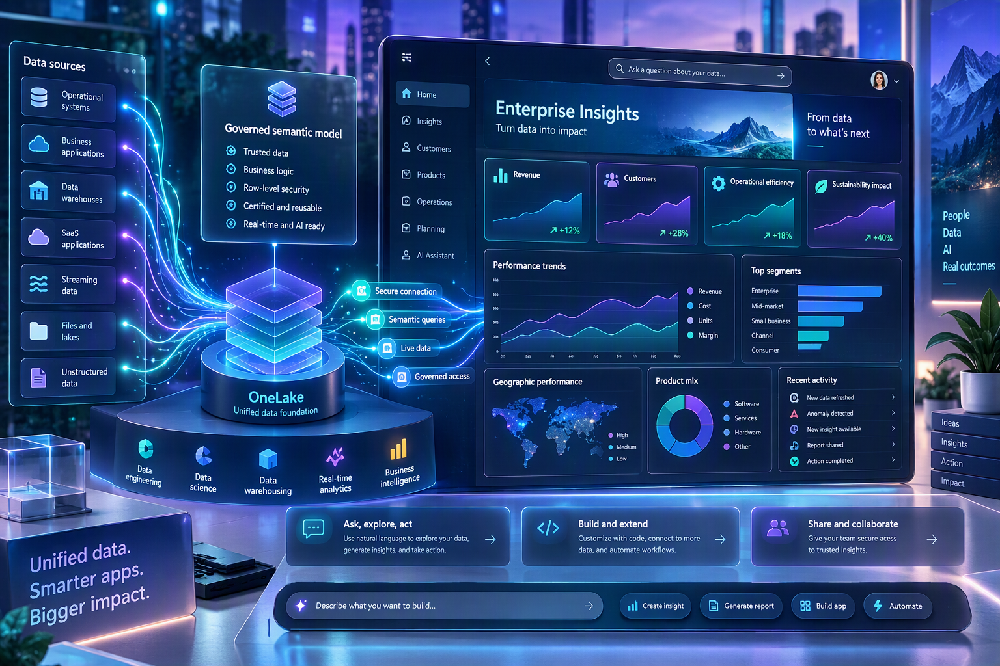
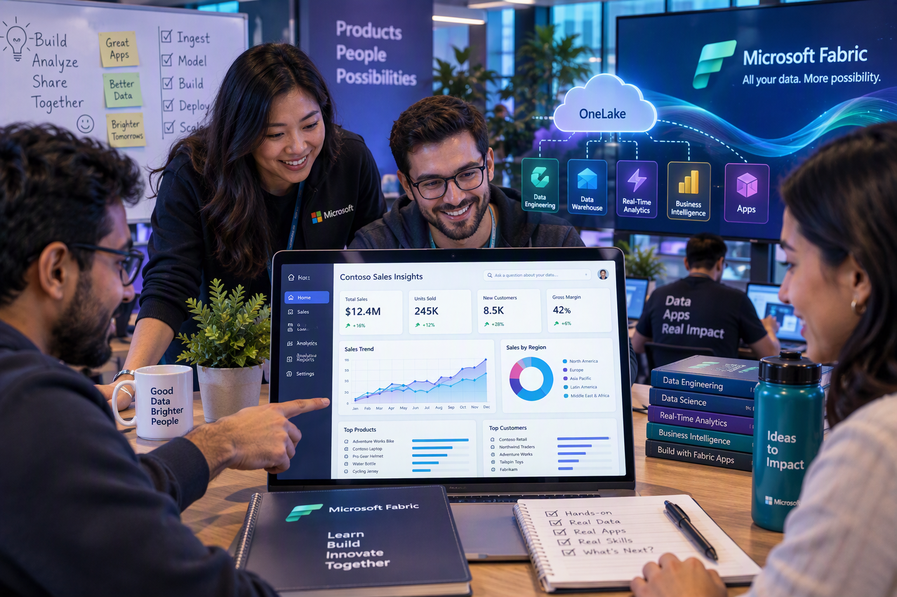

<div align="center">

# Fabric Apps on a Semantic Model

### Partner Opportunity Command Center — Hands-on Lab

Build a governed, interactive Microsoft Fabric data app on top of a semantic model.

[](https://www.microsoft.com/microsoft-fabric)
[](docs/LAB_GUIDE.md)
[](LICENSE)

[Start the lab](docs/LAB_GUIDE.md) · [Download the presentation](Fabric-Apps-Semantic-Model-HOL.pptx) · [Review pricing guidance](docs/PRICING.md)

</div>


## Why this lab

This partner-ready workshop shows how to turn trusted business data into an application experience without moving business logic out of the governed semantic layer. Participants build a **Partner Opportunity Command Center** for exploring annual contract revenue (ACR), pipeline stages, regions, solution areas, partner performance, and delivery health.

The package is designed for instructor-led delivery or self-paced learning and includes everything needed to run the scenario with synthetic data.

## What participants will build



By the end of the lab, participants will have an app experience with:

- Executive KPIs for pipeline value, opportunity count, won ACR, win rate, and average ACR
- Interactive filters for region, partner, solution, stage, and delivery health
- Stage funnel, regional comparison, partner leaderboard, and solution mix
- Searchable opportunity details and a selected-opportunity side panel
- Accessible loading, empty, and error states
- Fabric-governed identity, permissions, and semantic-model calculations

## Architecture



```text
Synthetic Excel / CSV
          │
          ▼
Fabric Lakehouse or Warehouse
          │
          ▼
Power BI semantic model
          │
          ▼
Fabric semantic-model connector
          │
          ▼
Partner Opportunity Command Center
```

Business calculations remain in the semantic model. The app layer is responsible for presentation, interaction, and workflow.

## Learning outcomes

Participants will learn how to:

1. Load workshop data into Microsoft Fabric.
2. Create and validate a star-schema semantic model.
3. Define reusable DAX measures for the application.
4. Scaffold a Fabric data app with the Rayfin CLI.
5. Connect the app securely to a semantic model.
6. Build KPI, filtering, analytical, and detail experiences.
7. Test data accuracy, permissions, accessibility, and responsiveness.
8. Publish the finished app as a governed Fabric item.

## Workshop at a glance

| Phase | Activity | Approx. time |
|---|---|---:|
| 1 | Prepare the workspace and load sample data | 15 min |
| 2 | Build and validate the semantic model | 20 min |
| 3 | Scaffold the Fabric data app | 10 min |
| 4 | Build the command center with Copilot | 30 min |
| 5 | Validate and publish | 15 min |
| **Total** | | **90 min** |

> [!TIP]
> For an instructor-led session, reserve 15 additional minutes for introductions, discussion, and troubleshooting.

## Prerequisites

| Requirement | Details |
|---|---|
| Microsoft Fabric | Access to a Fabric-enabled tenant and a workspace assigned to capacity |
| Workspace role | Contributor, Member, or Admin |
| Semantic-model access | Build and Read permissions |
| Tenant configuration | Fabric Apps and the Semantic Model Execute Queries REST API enabled |
| Local tooling | Node.js 20 or later, Git, and Visual Studio Code |
| Recommended | GitHub Copilot for the guided prompt sequence |

## Quick start

1. Download or clone this repository.
2. Open the [participant lab guide](docs/LAB_GUIDE.md).
3. Use [the sample workbook](sample-data/partner-opportunity-sample.xlsx) or [the flat CSV](sample-data/fact-opportunities.csv).
4. Follow the [Copilot prompt sequence](prompts/copilot-prompts.md) while building the app.
5. Use the included [instructor presentation](Fabric-Apps-Semantic-Model-HOL.pptx) to facilitate the workshop.

Replace every value shown in `{BRACES}` with the corresponding value from your Fabric environment.

## Repository contents

| Resource | Purpose |
|---|---|
| [`docs/LAB_GUIDE.md`](docs/LAB_GUIDE.md) | Step-by-step participant instructions and validation checkpoints |
| [`Fabric-Apps-Semantic-Model-HOL.pptx`](Fabric-Apps-Semantic-Model-HOL.pptx) | 12-slide instructor deck with speaker notes |
| [`sample-data/partner-opportunity-sample.xlsx`](sample-data/partner-opportunity-sample.xlsx) | Synthetic star-schema workbook with fact, dimension, and summary sheets |
| [`sample-data/fact-opportunities.csv`](sample-data/fact-opportunities.csv) | Flat-file alternative for the same scenario |
| [`prompts/copilot-prompts.md`](prompts/copilot-prompts.md) | Guided GitHub Copilot prompt sequence |
| [`docs/PRICING.md`](docs/PRICING.md) | Capacity monitoring and commercial guidance |

## Responsible delivery

- All data in this repository is synthetic and intended only for demonstrations and training.
- Do not commit tenant IDs, workspace IDs, access tokens, connection strings, or other secrets.
- Validate every displayed value against the semantic model before demonstrating the app.
- Test both authorized and unauthorized access paths.
- Review [pricing and capacity guidance](docs/PRICING.md) before planning a production deployment.

## License

This project is available under the [MIT License](LICENSE).
