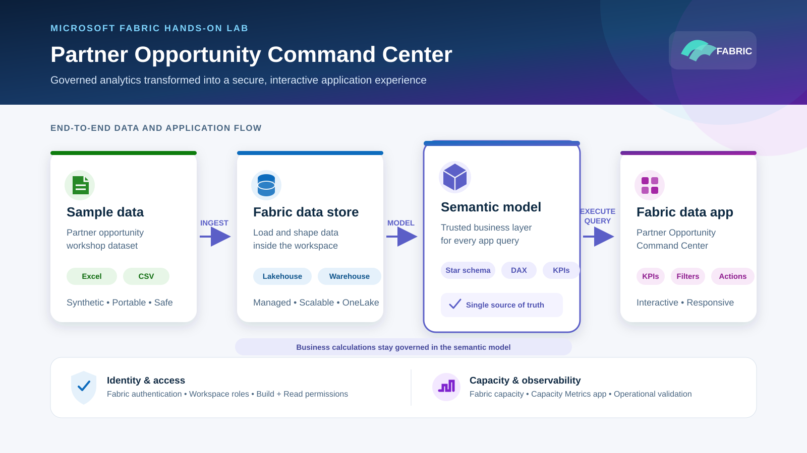

# Hands-on Lab: Partner Opportunity Command Center

In this lab, you will build a Microsoft Fabric data app backed by a governed semantic model. The finished experience gives partner teams a clear view of opportunity value, pipeline stage, region, solution area, and delivery health.

| | |
|---|---|
| **Estimated duration** | 90 minutes |
| **Difficulty** | Intermediate |
| **Lab format** | Instructor-led or self-paced |

## Lab architecture



The architecture keeps data preparation, business logic, and application interaction in distinct layers:

1. Load the synthetic Excel or CSV dataset into a Fabric Lakehouse or Warehouse.
2. Model relationships, measures, and KPIs in the governed Power BI semantic model.
3. Use the Fabric semantic-model connector to execute authenticated queries.
4. Present trusted results through the Partner Opportunity Command Center.

Fabric identity, workspace permissions, capacity, and operational monitoring apply across the complete solution.

## What you will build


Your app will include:

- An executive KPI strip
- Region, partner, solution, stage, and health filters
- A stage funnel and regional ACR comparison
- A partner leaderboard and solution mix
- A searchable opportunity detail grid
- Loading, empty, permission-denied, and error states

## Before you begin

Confirm that you have:

- Node.js 20 or later
- Access to a Microsoft Fabric tenant
- A Fabric workspace assigned to capacity
- Contributor, Member, or Admin permission on the workspace
- Fabric Apps enabled by your tenant administrator
- The Semantic Model Execute Queries REST API tenant setting enabled
- Build and Read permissions on the semantic model
- Visual Studio Code and GitHub Copilot, if using the guided prompts

Before an instructor-led workshop, complete the [setup readiness checklist](SETUP_CHECKLIST.md).

> [!IMPORTANT]
> Never commit tenant IDs, workspace IDs, access tokens, connection strings, or other secrets. Values in `{BRACES}` are placeholders and must be replaced locally.

## Part 1 — Prepare the data

### 1.1 Create or select a workspace

1. Sign in to Microsoft Fabric.
2. Create a workspace or open an existing workshop workspace.
3. Confirm that the workspace is assigned to Fabric capacity.
4. Confirm that you have at least Contributor access.

### 1.2 Load the sample data

Use one of these options:

| Option | File | Best for |
|---|---|---|
| Recommended | [`partner-opportunity-sample.xlsx`](../sample-data/partner-opportunity-sample.xlsx) | Building the complete star schema |
| Alternative | [`fact-opportunities.csv`](../sample-data/fact-opportunities.csv) | A quick flat-table demonstration |

The Excel workbook contains:

- `FactOpportunities`
- `DimRegion`
- `DimPartner`
- `DimSolution`
- `LabSummary`

Import the selected file into a Fabric Lakehouse or Warehouse. Confirm that identifier, category, and date columns have the expected data types before continuing.

### Checkpoint

You should be able to preview opportunity rows in Fabric and see values for date, stage, ACR, workload units, and health.

## Part 2 — Build the semantic model

### 2.1 Create relationships

Create these many-to-one relationships with single-direction filtering from each dimension to the fact table:

| Fact column | Dimension column |
|---|---|
| `FactOpportunities[RegionID]` | `DimRegion[RegionID]` |
| `FactOpportunities[PartnerID]` | `DimPartner[PartnerID]` |
| `FactOpportunities[SolutionID]` | `DimSolution[SolutionID]` |

### 2.2 Create measures

Add the following measures to the semantic model:

```dax
Total ACR =
SUM ( FactOpportunities[ACR_USD] )
```

```dax
Opportunity Count =
DISTINCTCOUNT ( FactOpportunities[OpportunityID] )
```

```dax
Won ACR =
CALCULATE (
    [Total ACR],
    FactOpportunities[Stage] = "Won"
)
```

```dax
Won Opportunities =
CALCULATE (
    [Opportunity Count],
    FactOpportunities[Stage] = "Won"
)
```

```dax
Win Rate =
DIVIDE ( [Won Opportunities], [Opportunity Count] )
```

```dax
Average ACR =
DIVIDE ( [Total ACR], [Opportunity Count] )
```

Format `Total ACR`, `Won ACR`, and `Average ACR` as currency. Format `Win Rate` as a percentage.

### 2.3 Establish a baseline

Create a simple Power BI report page containing:

1. A card for each measure.
2. A table grouped by region.
3. A table grouped by stage.
4. Slicers for partner, solution, and health.

Record the unfiltered KPI values. You will use these as your application validation baseline.

Compare your results with the published [validation baseline](VALIDATION_BASELINE.md). Do not continue until the row count and unfiltered KPIs match.

### Checkpoint

- All three relationships are active.
- Every measure returns a value.
- Selecting a dimension filters the expected fact rows.
- The baseline report contains no model or permission errors.

## Part 3 — Create the Fabric data app

Open a terminal in the folder where you want to create the application.

### 3.1 Scaffold the app

```bash
npm create @microsoft/rayfin@latest -- "partner-opportunity-command-center" --template dataapp --workspace "{WORKSPACE_NAME}"
cd partner-opportunity-command-center
```

Run the version-matched package installation command printed by the CLI.

### 3.2 Find the semantic model

```bash
npx rayfin connector search --workspace-id "{WORKSPACE_ID}" --type fabric-semanticmodel --json
```

From the output, identify the item ID for the semantic model created in Part 2.

### 3.3 Add the connector

```bash
npx rayfin connector add --type fabric-semanticmodel --workspace-id "{WORKSPACE_ID}" --item-id "{SEMANTIC_MODEL_ITEM_ID}" --name opportunityModel --operations executeQuery
```

Keep environment-specific identifiers in local configuration. Do not paste credentials or tokens into source files or Copilot prompts.

### Checkpoint

- The app starts without dependency or configuration errors.
- `opportunityModel` appears in the available data connections.
- An authenticated test query returns data from the semantic model.

## Part 4 — Build the experience

Open [`copilot-prompts.md`](../prompts/copilot-prompts.md) and run the prompts in order. Review every proposed change before accepting it.

### 4.1 Build the application shell

Create responsive navigation for:

- Overview
- Partners
- Opportunities
- Data Quality

Use accessible color contrast, visible focus states, meaningful page titles, and layouts that work on desktop and tablet widths.

### 4.2 Add the executive overview

Display:

- Total ACR
- Opportunity Count
- Won ACR
- Win Rate
- Average ACR

Add filters for region, partner, solution, stage, and health. Every number must come from a semantic-model query.

### 4.3 Add analytical interactions

Build:

- A stage funnel
- Regional ACR comparison
- Partner ranking
- Solution mix

Selecting a region or partner should cross-filter related visuals. Keep business aggregations in semantic-model measures rather than recreating them in JavaScript.

### 4.4 Add opportunity details

Create a searchable, sortable grid containing:

- Opportunity ID
- Partner
- Region
- Solution
- Stage
- ACR
- Workload units
- Health

Add a side panel that shows the selected opportunity without losing the current filter context.

### 4.5 Add resilient states

Provide a clear experience for:

- Initial loading
- No matching results
- Query failure
- Missing Build or Read permission
- Connector configuration failure

Do not replace failed queries with mock data or success-shaped fallbacks.

### Completion reference


Use this visual as the presentation target. Your implementation does not need to reproduce every visual detail, but it must include the required KPIs, filters, analysis, opportunity grid, and resilient states.

## Part 5 — Validate the solution

### 5.1 Validate data

Use this checklist for every KPI and visual:

| Test | Expected result |
|---|---|
| No filters | Matches the Power BI baseline |
| One filter | Matches the same filter in Power BI |
| Multiple filters | Uses intersection behavior and matches Power BI |
| Empty combination | Shows a clear empty state |
| Filter reset | Returns to the unfiltered baseline |
| Currency and percentage | Uses the expected formatting |

### 5.2 Validate access

Test with:

1. A user who has Build and Read permission.
2. A user who does not have the required permission.

Authorized users should see data. Unauthorized users should receive a clear access message without exposing technical secrets.

### 5.3 Validate the experience

- Navigate the complete app using only a keyboard.
- Confirm that focus is visible and follows a logical order.
- Check text and data visualization contrast.
- Resize the app to desktop and tablet widths.
- Confirm that loading and error messages are announced appropriately.
- Verify that search, sort, filter, and selection states work together.

### 5.4 Validate repository safety

Before publishing, confirm that the repository contains no:

- Access tokens or credentials
- Tenant-specific secrets
- Connection strings
- Personal or customer data
- Local `.env` files

## Part 6 — Publish

Use the Fabric Apps deployment flow for your environment.

After deployment:

1. Open the deployed app from Fabric.
2. Repeat the baseline KPI check.
3. Test with both authorized and unauthorized users.
4. Confirm the app uses the intended workspace and semantic model.
5. Record the app owner, support contact, and review date.

The app remains governed by Fabric identity and the permissions on the underlying semantic model.

## Troubleshooting

| Symptom | What to check |
|---|---|
| Semantic model is not returned by connector search | Workspace ID, user access, model location, and tenant settings |
| Query returns a permission error | Build and Read permissions and the Execute Queries tenant setting |
| KPI does not match Power BI | Filter context, relationship direction, measure definition, and formatting |
| App shows no rows | Active filters, connector configuration, and semantic-model query output |
| CLI command is unavailable | Node.js version, package installation output, and the terminal working directory |
| App works locally but not after deployment | Deployment configuration, target workspace, identity, and permissions |

## Challenge extension

Add a **Partner Action Plan** panel that converts the current filters into a prioritized follow-up list. Keep calculations and business definitions in the semantic model; use the app layer only for interaction and workflow presentation.

Suggested acceptance criteria:

- The panel reflects the active region, partner, stage, and health filters.
- High-value or at-risk opportunities are clearly prioritized.
- Every recommendation links back to the underlying opportunity.
- Clearing filters resets the action plan.

## Workshop cleanup

If the lab used temporary resources:

1. Remove or archive the deployed app.
2. Remove temporary Fabric items and sample data.
3. Revoke workshop-only permissions.
4. Review capacity usage in the Microsoft Fabric Capacity Metrics app.

For production planning, review the [pricing and capacity guidance](PRICING.md).

For instructor-led delivery, use the [instructor guide](INSTRUCTOR_GUIDE.md). For private repository onboarding, follow the [partner access guide](PARTNER_ACCESS.md).
